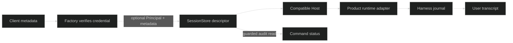

# Attribution and audit

A hosted product can record who submitted each command without asking clients
to assert their own identity. Factory verifies the credential, then optionally
stamps a `sessionwire/v1.Principal` onto the durable command. The product still
decides who may read a session and its audit fields. A model does not see the
principal merely because it is recorded; use a [Message presenter](/docs/guides/harness/commands/message-presenter)
when the agent needs trusted, model-visible sender context.

## Two separate fields

| Field | Source | Purpose |
| --- | --- | --- |
| `Principal{Tenant, Subject, Kind}` | Factory's verified credential after `WithPrincipalStamping` | Recorded sender; `Kind` is `actor` or `service`. Display names are not identity. |
| `MessageMetadata` | Client's create or input request | App-defined string fields, such as a UI surface; not identity or authority. |

The client may send metadata but never a `principal`: Factory refuses a
client-supplied principal on REST and ClientLink, even when stamping is off.
Core permits at most 16 metadata fields, a key of at most 64 bytes beginning
with a lowercase letter and continuing with lowercase letters, digits, or
underscores, a value of at most 1024 UTF-8 bytes, and 4096 bytes for the
canonical object. Keys beginning with `looprig` are reserved. Metadata is
allowed only on create and input, while a stamped principal accompanies every
command kind. The [Core validators](https://github.com/looprig/core/blob/v0.13.1/sessionwire/v1/metadata.go)
enforce these bounds; a valid shape does not make client data trusted. On the
wire, omit metadata when absent: explicit `null`, `{}`, and non-string values
are refused. Values must be valid UTF-8; control characters below U+0020 are
refused except tab and newline.

## Admission and runtime

`factory.WithPrincipalStamping()` is off by default. Enable it only after
upgrading every Host and confirming each advertises Core's exact
`hostlink.attribution.principal` capability token. It is a token read through
the HostLink negotiation reply, not an RPC method. Factory refuses an
attributed command for an incapable resident before any durable write; it
skips incapable placement candidates. An unavailable capability probe is
transient and retryable, not evidence that a Host supports the feature.

This gate also applies to metadata-only commands when stamping is disabled.
An incapable resident returns HTTP 422 `runtime_unavailable`
(`identity.ErrMetadataUnsupported`); a resident whose capability cannot be
queried returns retryable HTTP 503. Placement skips incapable candidates and
waits with `NoCapacity`. Principal and metadata are part of canonical command
identity: retrying a command ID under a different subject or with changed
metadata returns HTTP 409 `command_rejected`, without changing the stored sender.

Clients can read `GET /v1/capabilities`: `message_metadata` is `true`, while
`command_principal` reports whether this Factory enabled stamping. The existing
`/v1/agents` response is unchanged. With stamping enabled, `Start` probes
registered pooled Hosts and warns about missing capability or failed probes.
The informational scan has a 30-second budget and a 64-page limit per target;
exhausting either warns that some Hosts remain unchecked. Shutdown cancellation
does not produce a capability warning. Admission and placement still check
capability independently of this startup scan.

The disposition descriptor preserves `Principal` and `Metadata`; SessionStore
validates their shape but does not verify a sender. Host reads them before
dispatch and passes them to the product runtime. A field-by-field adapter to
`runtimecommand.Admitted` must copy both members or attribution disappears
silently. Harness records attribution on applicable intents and events; restore
attribution remains in the SessionStore descriptor. A browser UI such as Carbon's displays an optional sender chip and separates any
model-visible presenter frame from the user's original blocks. Metadata is
not rendered as identity. [The cross-module integration test](https://github.com/looprig/tests/blob/v0.15.0/principal_presenter_integration_test.go)
exercises create, input, interrupt, restore, gate response, replay, and
redelivery through this chain.

## Host decoding and recovery

Host strictly decodes the stored Core body after claiming a command and before
starting a dispatch attempt. This preserves a retry path for a newer reader:

| Stored body | Result before dispatch |
| --- | --- |
| Permanently malformed body | Rejected. |
| Unknown field or unsupported version on input, interrupt, or restore; by-reference body for those kinds | Remains claimed with `unreadable_command`, without an attempt. |
| Unreadable create (and, before Host v0.14.0, a by-reference create) | `unreadable_create`. |
| Future member on a gate response | `unreadable_gate_response`; Hosts through v0.10.3 rejected it. |
| Valid gate response without a configured gate reader | `no_gate_reader`. |

An input over 64 KiB is stored by reference. Host v0.11.0 through v0.13.0 leave
it unapplied before an attempt, awaiting a capable reader or Factory's deadline
sweep. Host v0.14.0 reads a referenced create, input, or gate response in the
command's own tenant and session scope, verifies its size and SHA-256, and
hands the runtime verified bytes, bounded by `Composition.MaxCommandBodyBytes`
(default 8 MiB). It advertises `hostlink.payload.reference`, and Factory v0.14.0
places such a session only on a Host that does. Product `BlockDecoder`
implementations receive the input body unchanged. A decoder using Core's
strict `InputRequest` needs Core v0.12.0 or later to accept the new members;
create's initial message is passed in input shape with its attribution.

## Public transcript and native journal

Harness's public projection retains `input.principal` and removes
`input.metadata`. Read native metadata through `ReadRuntimeJournal`, or use
Factory's separately authorized command audit read below. If a presenter
renders metadata into text, that text is part of the public message, so a
product should choose explicitly which fields it exposes.

`TurnStarted`, `TurnFoldedInto`, and `InputCancelled` carry `input` with the
principal, native metadata, and presenter prefix/suffix block counts.
`TurnInterrupted` and `GateResolved` carry a principal. A restore command's
principal lives in the SessionStore disposition descriptor, not a Harness
journal intent. Event envelope version remains 1, and records without the
new members retain their previous encoding.

## Guarded audit read

`GET /v1/sessions/{sid}/commands/{cid}` returns public command status after
the ordinary session-read authorization. Its `principal` and `metadata`
members are appended only if the supplied Factory authorizer also implements
`AuditAuthorizer` and `AuthorizeAuditRead` grants this principal access to the
session. If that optional interface is absent, denies access, or faults,
Factory still returns status but omits both audit members. This is a separate
grant: `TenantAuthorizer` grants audit reads within the caller's tenant, but a
custom authorizer must implement the optional interface explicitly. Being
allowed to see command status does not by itself reveal who sent it or the client's metadata. [Factory's route](https://github.com/looprig/factory/blob/v0.15.0/internal/httpapi/commands.go)
and [authorizer seam](https://github.com/looprig/factory/blob/v0.15.0/server.go)
define the behavior.

## Rollout and recovery

Roll out every Host at v0.11.0 or later first, then Factory v0.12.0, and only
then enable `WithPrincipalStamping`. A retry admitted before stamping is
enabled has different command identity and is refused, so switch during a
quiet period. The [old-Host integration lane](https://github.com/looprig/tests/blob/v0.15.0/old_host_probe_integration_test.go)
checks that an older Host never receives a stamped command.

The data upgrade is one-way. Once a version-3 attributed command is stored,
every Factory and Host sharing it must stay on sessionstore v0.14.0 or later;
older readers refuse that row and can wedge command consumption. Once an
attributed or presented journal record exists, rolling Harness below harness
v0.41.0 is lossy and forbidden: old decoders do not refuse it, but silently
drop the additive attribution or presenter frame on re-offer. Metadata-only
records also establish this rollback floor, even with stamping disabled. The safe
recovery path is to keep the new readers and restore the recorded command,
not to roll back the journal consumer.

## Source

- [Core `Principal`](https://github.com/looprig/core/blob/v0.13.1/sessionwire/v1/principal.go), [metadata rules](https://github.com/looprig/core/blob/v0.13.1/sessionwire/v1/metadata.go), and [HostLink capability](https://github.com/looprig/core/blob/v0.13.1/sessionwire/v1/hostlink_framing.go)
- [Factory stamping option](https://github.com/looprig/factory/blob/v0.15.0/options.go), [authorization seam](https://github.com/looprig/factory/blob/v0.15.0/server.go), and [command status route](https://github.com/looprig/factory/blob/v0.15.0/internal/httpapi/commands.go)
- [SessionStore descriptor](https://github.com/looprig/sessionstore/blob/v0.14.0/disposition_inbox.go), [Host adapter](https://github.com/looprig/host/blob/v0.14.0/internal/harnessadapter/session.go), and [Harness admitted command](https://github.com/looprig/harness/blob/v0.41.1/pkg/runtimecommand/command.go)

- [Factory capability response](https://github.com/looprig/factory/blob/v0.15.0/internal/httpapi/reads.go) and [startup probe](https://github.com/looprig/factory/blob/v0.15.0/serve.go)
- [Host pre-attempt decoding](https://github.com/looprig/host/blob/v0.14.0/internal/commands/apply.go) and [body taxonomy tests](https://github.com/looprig/host/blob/v0.14.0/internal/commands/principal_precheck_test.go)
- [Harness message attribution](https://github.com/looprig/harness/blob/v0.41.1/pkg/event/message_input.go)

## Proof

- [Principal, metadata, presenter, restore, and redelivery](https://github.com/looprig/tests/blob/v0.15.0/principal_presenter_integration_test.go)
- [Incapable old Host stays out of attributed delivery](https://github.com/looprig/tests/blob/v0.15.0/old_host_probe_integration_test.go)
- [Factory audit-member authorization](https://github.com/looprig/factory/blob/v0.15.0/internal/httpapi/commands_test.go)
