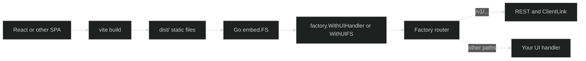

# Embedding

Factory ships no UI of its own. You build a single-page app with `@looprig/client` or `@looprig/react`, compile it to static files, and hand those files to Factory, which serves them from the same origin as its API. The browser then reaches `/v1/...` REST routes and the `/v1/realtime` ClientLink with relative paths, and Factory's cookie, origin, and CSRF checks apply without any cross-origin configuration.

## What embedding means here

Embedding is a server-side composition step, not a package. Neither npm package contains a Go handler, and the earlier Go `webui` package and prebuilt `wui` bundle are retired. Carbon's embedded asset package is internal to Carbon and cannot be imported. Your application owns the build, the Go `embed` directive, and the option that mounts it on Factory.

## Build and serve flow



Factory's router sends every path whose first segment is `v1` to its own API and every other path to the UI handler. An unclean API path is refused rather than redirected, so an asset request can never fall through into the API or the reverse.

## Who owns what

| Concern | Owner |
| --- | --- |
| Session reads, commands, live streams, gate answers | Factory, reached through `@looprig/client` |
| Authentication, origin checks, CSRF tokens | Factory, configured by your server with `WithCSRF` and a credential verifier |
| Static assets and the SPA fallback | Your UI handler |
| `Content-Security-Policy` for your documents | Your UI handler; Factory sets `X-Content-Type-Options`, `Referrer-Policy`, and `X-Frame-Options` defaults but no CSP |
| Feature detection and version pairing | Your app, through `/v1/capabilities` |

## Factory UI options

```go
// Pick one of these. Supplying both WithUIHandler and WithUIFS makes factory.New
// fail with factory.ErrConflictingUI.
factory.WithUIFS(dist)          // serves dist with http.FileServerFS, no SPA fallback
factory.WithUIHandler(handler)  // your own handler, for example with an index.html fallback

// Optional, alongside either: application routes under /ui/ that run after
// Factory authenticates the caller and checks origin and CSRF.
factory.WithUIRoutes(uiRoutes, authorizeUIRoute)
```

`WithUIFS` is enough for an app that uses hash routing or only the root path. An app with browser-history routes such as `/sessions/{sid}` needs `WithUIHandler` and a handler that returns `index.html` for unknown paths, which is how Carbon serves its app.

Continue with [Static bundle](/docs/guides/web-ui/embedding/static-bundle) for the build and the Go handler, then [Application integration](/docs/guides/web-ui/embedding/app-integration) for Factory wiring, CSRF, capability checks, and version pairing.

## Source

The browser side of this boundary is `createFactoryClient` in [`packages/client/src/client.ts`](https://github.com/looprig/client/blob/v0.3.0/packages/client/src/client.ts), which derives same-origin `/v1/realtime` when no `baseUrl` is given. The server options are in Factory's [`options.go`](https://github.com/looprig/factory/blob/v0.16.1/options.go), and the path split and security headers in [`internal/httpapi/routes.go`](https://github.com/looprig/factory/blob/v0.16.1/internal/httpapi/routes.go). Carbon's composition is [`browser/factory.go`](https://github.com/looprig/carbon/blob/v0.34.2/browser/factory.go).

## Proof

[`packages/client/test/vanilla-consumer.test.ts`](https://github.com/looprig/client/blob/v0.3.0/packages/client/test/vanilla-consumer.test.ts) installs the packed client into a clean consumer. Carbon v0.32.2 is a released consumer that composes `factory.WithUIHandler` with its embedded bundle. The next page, [Static bundle](/docs/guides/web-ui/embedding/static-bundle), shows the build side.
