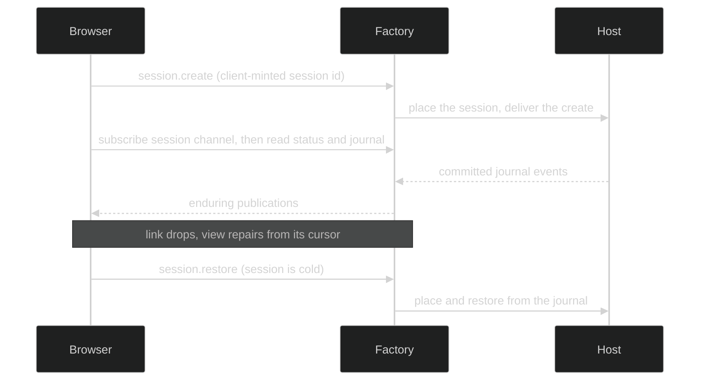

# Session lifecycle

A browser works with a session through Factory alone. It never addresses the Host that runs the agent: Factory owns the durable session record, admits commands, places sessions on Hosts, and relays the public journal back. This section follows one session through the client's view of that lifecycle. For the server side, see the [Factory](/docs/modules/factory) and [Host](/docs/modules/host) module pages.

## The lifecycle at a glance



| Stage | Client API | Page |
|---|---|---|
| Find or create a session | `reads.listRecentSessions()`, `commands.create()` | [Commands and gates](/docs/guides/web-ui/client-sdk/commands) |
| Bind a view to it | `link.subscribe({ tenantId, sessionId, ... })` | [Binding a session](/docs/guides/web-ui/sessions/binding) |
| Show history and live events | `joinFactorySessionView`, `FactorySessionViewStore` | [Reconnect and exact joins](/docs/guides/web-ui/sessions/reconnect) |
| Bring a cold session back | `commands.restore(sessionId)` | [Restore a session](/docs/guides/web-ui/sessions/restore) |

## Reading state and residency

`reads.readStatus(sessionId)` returns Core's `SessionStatus`, validated. It has two independent axes: `state` says what the session is doing, and `residency` says whether a Host currently holds it. An idle session can stay resident, and a cold session is still fully readable.

```ts
import { statusRunning, type FactorySessionStatus } from "@looprig/client";

const status: FactorySessionStatus = await client.reads.readStatus(sessionId);
// state: running, waiting_on_gate, suspended, restoring, idle, failed, interrupted, stopped
// residency: cold, attaching, resident, releasing
const busy = statusRunning(status); // true for running or waiting_on_gate
const offerRestore = status.residency === "cold";
```

Both fields are plain strings in the schema, and Core may add values in a later wire version. Treat an unfamiliar value as a state you cannot control, not as a missing session. Do not use `status.journal_tip` as a journal position: for a Host session it can disagree with the journal, which is why the join takes the tip from the journal page instead.

## Viewing is a read

Opening a session view subscribes to its channel and reads status, gates, and a bounded tail. It sends no command, so looking at a list of cold sessions does not place any of them on a Host. Placement follows a command: Factory places a session that has pending work and no live owner. Sending input to a cold session is enough; `restore` exists for bringing one back without a message. The React hook `useFactorySessionView` follows the same rule (see [Session views and lists](/docs/guides/web-ui/react/session-view)).

## Source

Status reads are in [`packages/client/src/factory-rest.ts`](https://github.com/looprig/client/blob/v0.2.0/packages/client/src/factory-rest.ts), the status schema in [`schema.ts`](https://github.com/looprig/client/blob/v0.2.0/packages/client/src/schema.ts), `statusRunning` in [`factory-view.ts`](https://github.com/looprig/client/blob/v0.2.0/packages/client/src/factory-view.ts), and the read-only session view in [`packages/react/src/use-session-view.ts`](https://github.com/looprig/client/blob/v0.2.0/packages/react/src/use-session-view.ts).

## Proof

[`join.test.ts`](https://github.com/looprig/client/blob/v0.2.0/packages/client/test/join.test.ts) reads status alongside the journal and checks that the page's tip wins when a Host session's status reports 0, and [`contract.test.ts`](https://github.com/looprig/client/blob/v0.2.0/packages/client/test/contract.test.ts) validates the status schema against Core's fixture. [`use-session-view.test.tsx`](https://github.com/looprig/client/blob/v0.2.0/packages/react/src/use-session-view.test.tsx) exercises the read-only view. Start with [Binding a session](/docs/guides/web-ui/sessions/binding).
