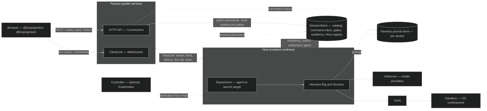
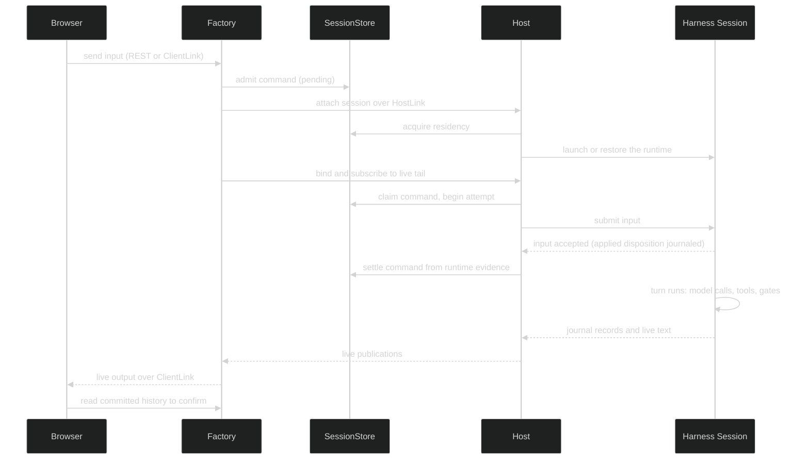
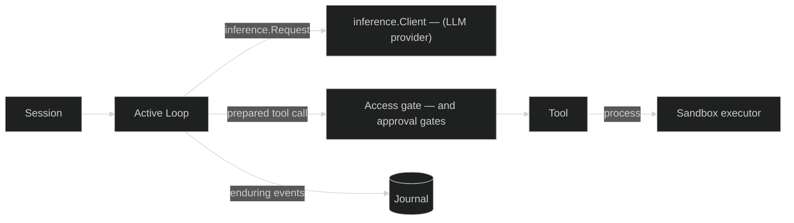

# Architecture

Looprig is layered. Contracts sit at the bottom (Core, Storage, Inference), the agent runtime sits in the middle (Harness, with Tools and Sandbox beside it), and the serving layer sits on top (Factory, Host, SessionStore, and the browser packages). You can stop at any layer. The [Which modules do I need?](/docs/overview/which-modules) page maps each layer to the modules and versions to install.

## Two ways to run an agent

**In your own process.** Your program defines a Loop, assembles a Rig, and runs a Session directly. Events stream to your code, and the Session's journal goes to a Harness session store. A CLI, a TUI, a test, or a backend job all work this way. The [Quickstart](/docs/start/quickstart) is the smallest example.

**As a hosted service.** Browsers and API clients talk to Factory. Factory never runs an agent itself; it records commands in SessionStore and places each session on a Host, which runs the same Harness Rigs you would run in your own process. Factory and Host can share one process or run as separate deployments, pooled or one Host per session. [Stack](/docs/modules/stack) is the supported way to run them in one process.

The rest of this page describes the hosted shape, because it has the most moving parts. The runtime inside a Host is the same as the in-process one.

## The hosted architecture

The storage cylinders are logical. Both usually live on the same backend, such as NATS JetStream or PostgreSQL with S3, through the [Storage](/docs/modules/storage) contract.

| Part | Role |
| --- | --- |
| `@looprig/client`, `@looprig/react` | Browser SDK and React hooks. They read history over REST, follow live output over ClientLink, and repair gaps from committed history. |
| [Factory](/docs/modules/factory) | The public API. Verifies identity through seams you supply, admits commands, places sessions on Hosts, and relays live output to viewers. |
| ClientLink | Factory's browser WebSocket: one link per application carries live publications for every watched session plus command calls. |
| [SessionStore](/docs/modules/sessionstore) | Durable records Factory, Host, and Controller share, so none of them needs to call another to agree on state. |
| HostLink | The WebSocket between Factory and each Host, one link per Host and tenant. Hosts advertise capabilities on it, and Factory uses a feature only on a Host that advertises it. |
| [Host](/docs/modules/host) | Keeps sessions resident, applies admitted commands, publishes open gates, and drains on release. |
| Department | The Host's immutable map from agent identity to the product code that launches that agent's runtime. |
| [Harness](/docs/modules/harness) | The agent runtime: Loops, Rigs, Sessions, tools, gates, and the journal. |
| [Controller](/docs/modules/controller) | Optional. Runs one dedicated Host Pod per session on Kubernetes and drains before deleting. |

## Stack: the hosted system in one process

[Stack](/docs/modules/stack) composes the hosted architecture in a single process from one `stack.Options` value: Factory, one pooled Host running in the same process, and one storage profile. It is the embedded mode, not a different architecture. Factory still reaches the in-process Host over a loopback HostLink WebSocket and shares state with it only through SessionStore, exactly as it would reach a remote Host, so an agent that runs under Stack runs unchanged on separate Hosts.

- **One source for the agreements.** Factory and Host must agree on the journal binding, each agent's launch template, the evidence Host settles commands from, and the resolvers Factory reads history through. Stack derives all of them from the same `Agents` list, so they cannot disagree.
- **Agents are Rig builders.** Each `stack.Agent` names an agent ID, a compatibility ID, its `department.Capabilities`, and a `Define` function that builds the Rig for every launch from a `stack.Binding` (tenant, session, the journal store to pass to `rig.WithSessionStore`, and an optional workspace root). Every agent runs through `host/harnessruntime`, described below.
- **Storage profiles.** `stack/localdisk` opens FSStore directories under one data directory for a single machine, `stack/memory` is for tests, and `stack/devauth` is a development-only identity that `Options.AllowDevelopmentIdentity` must enable. Stack v0.1.2 exposes no workspace snapshot store; an agent that places a workspace opens its own and must keep it durable, because a session restored after a restart against an in-memory snapshot store fails with `materialize_failed`.
- **Ordered shutdown.** `Stop` runs Factory `Quiesce`, Host `Stop` (the drain, while HostLink is still served), Factory `Stop`, and then closes storage last, on its own lifecycle: the caller's context bounds only the wait, and a retried `Stop` waits for the same teardown. It returns `*ParkedSessionsError` when the drain leaves a runtime running.
- **Moving Hosts out.** `stack.RemoteHosts{}` plus `stack.ServeHost` in each Host process moves the Hosts to other processes over shared storage, such as NATS or PostgreSQL with S3, with the same `Agents`.

The [browser-app starter](/docs/start/starters) is a complete program on Stack. Compose Factory and Host yourself when you need what Stack v0.1.2 does not include: an object policy, checkpointing, or dedicated placement.

## Agents on a Host

A Host launches runtimes through its Department, the map from agent identity to launch target. For Harness agents the launch target comes from the public [`host/harnessruntime`](/docs/modules/host) package: `harnessruntime.Target` binds your Rigs (`SharedRig`, `RigPerTenant`, or `RigsFunc`) to Host's runtime seams, and `harnessruntime.Registration` registers it for an agent ID. The adapter carries each command's `Principal` and `Metadata`, re-presents a create's first message, decodes gate responses, refuses an unresolved payload reference, relays live text, reasoning, and tool steps, and launches under the binding's runtime session ID, so a product no longer hand-writes it.

Host holds every launch target to a **runtime profile**. The default, `RuntimeProfileDurable`, makes `host.Compose` refuse a target that does not declare `department.Capabilities.Recovery`: an `AttemptCloser`, so a successor can close an attempt a crashed predecessor left in flight, and `PersistenceFaults`, so a journal fault ends residency instead of leaving a session resident and refusing commands. The declaration is checked again when each session launches. `harnessruntime.Target` declares and provides both. `RuntimeProfileBestEffort` admits a target without them and logs one warning at start; it is an explicit opt-out for runtimes that cannot recover. A custom runtime can check itself with `department/departmenttest.RunRuntimeConformance`.

## Who owns what

Each boundary has one owner, which is what lets the parts fail and restart independently.

- **Browser lifetime does not own runtime lifetime.** Closing a tab does not stop a session. Reopening it reads committed history and resumes live output.
- **Committed history is the source of truth.** Live output is an acceleration that the client can always rebuild from the journal, so a dropped connection loses nothing that was committed.
- **Cold reads do not need a resident Host.** Factory reads a session's committed history from storage even when no Host holds it.
- **Commands are durable before they run.** Factory admits a command into SessionStore first. A Host applies it and SessionStore settles it from the runtime's own recorded evidence.
- **Your product owns policy.** Identity, authorization, the UI, which agents exist, model providers, and storage backends are all supplied by you through Factory and Host options.

Factory imports neither Host nor Harness, and Host imports no Factory package. They agree only through [Core](/docs/modules/core) wire records and SessionStore records.

## How a message flows

This is what happens when a user types a message into a session that is not currently resident on any Host.

1. **Admission.** The browser sends the input through the REST API or a ClientLink command. Factory verifies the caller with your identity seam, authorizes the request, and writes the command into the session's inbox in SessionStore. From here the message is durable.
2. **Placement.** No Host holds the session, so Factory picks a live Host that advertises the capabilities this command needs and asks it to attach the session over HostLink. The Host acquires residency, a lease in SessionStore whose epoch fences out any earlier holder, then uses its Department to launch the agent's Rig, restoring from the journal if the session already has history.
3. **Delivery and settlement.** Factory binds the session to that Host and subscribes to its live tail. The Host claims the command, records the start of an attempt, and submits the input to the Harness Session. The runtime journals an `applied` disposition when its Loop accepts the input, before the turn runs, and the Host then settles the command in SessionStore from that evidence. For an input, `applied` means durably accepted, not that the answer is complete.
4. **Execution.** The Session runs a turn: the Loop calls the model through Inference, prepares tool calls, checks them against the access gate, and runs process tools inside the Sandbox when one is configured. If a tool needs approval, the runtime opens a gate; the Host publishes it to SessionStore, the browser shows it, and the user's answer arrives as another admitted command.
5. **Streaming.** Every committed record goes to the Harness journal. The Host forwards committed records, and optionally live text previews, over HostLink; Factory relays them to every viewer of the session over ClientLink.
6. **Confirmation.** The turn is finished when its records are committed to the journal. The browser confirms the answer by reading committed history, which Factory serves from the journal store, not by looking at the command's settlement.

## What happens on failure

- **The browser disconnects.** Nothing stops. On reconnect, the client reads committed history from its last cursor and rejoins the live stream.
- **A Host crashes.** Its residency lapses. Factory places a session automatically only when it still has a qualifying open command in SessionStore: one that is pending, claimed, or applying. The new Host acquires residency with a higher epoch and restores the runtime from the journal. Restoring the session and recovering a stranded command are separate steps: a command whose attempt had started but never settled is closed from journal evidence rather than blindly replayed, so it is not applied twice, which is why Host's durable runtime profile requires the runtime to provide `department.AttemptCloser`.
- **A turn is interrupted after its input settled.** An input settles as `applied` when the runtime accepts it, before the turn runs. If the Host dies mid-turn after that, the session has no open command, so Factory does not place it on that account; it is restored the next time a command arrives for it (for example a new input or an explicit restore), and restore records the open turn as interrupted and comes up idle rather than re-running it.
- **A Host is drained.** It refuses new attaches, releases every resident session, and returns a `DrainReport` listing anything an operator must reconcile. Factory can then place those sessions elsewhere. A runtime waiting at an approval gate refuses a graceful release, so the drain then abandons it crash-equivalently: nothing is journaled, the open gate is preserved, and the runtime stops and releases its journal lease, so a successor in this process or another restores the session with the gate still answerable. `DrainReport.Abandoned` lists those sessions. A session whose release or abandon failed, or whose runtime kept its lease, is listed in `DrainReport.Parked`; treat it as a leak, because no pinned storage backend expires a lease on its own. Size the platform's termination grace above the drain's `Grace` plus twice its `IdleBoundary`, since a gate-waiting session spends the whole grace being refused before it is abandoned.
- **Factory restarts.** Admitted commands are already in SessionStore, and a periodic sweep places any session with a pending, claimed, or applying command.

## Inside the runtime

Inside a Host, or inside your own process, the same Harness runtime runs every turn:

A Loop is the immutable definition of one agent; a Rig assembles Loops with storage and policy; a Session is one running or restorable instance. See the [Harness guide](/docs/guides/harness), [Gates](/docs/guides/harness/gates), and [Sandboxing](/docs/guides/sandboxing), and the [glossary](/docs/overview/glossary) for every term on this page.
