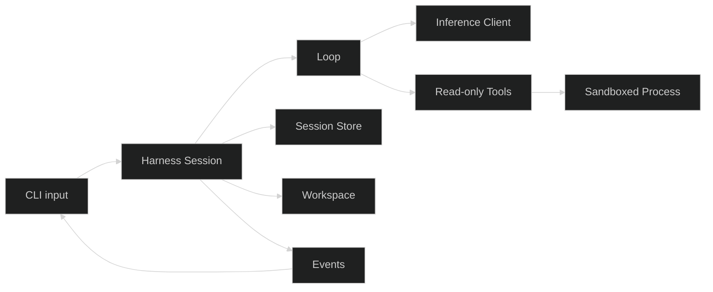

# Build a coding assistant

This tutorial builds a coding assistant that can answer a question, inspect files through declared tools, keep a resumable session, work inside a session-owned directory, and confine process tools. The final runtime is independent of its presentation, so you can keep the CLI or attach the TUI, Web UI, ACP, or MCP later.

## What you will build

The tutorial uses one project named `looprig-coding-assistant`. Each page adds one boundary without changing the responsibilities added earlier.

Every page ends with a complete, runnable program. Each one lives in its own directory under [`examples/go/start`](https://github.com/looprig/.github/tree/main/examples/go/start) with its `go.mod`, and continuous integration builds, tests, and runs each one on the released versions the pages name. The code shown on the pages is copied from those files byte for byte. Without a provider API key, every program runs against a scripted model from [`inferencetest`](/docs/modules/inference), so you can follow the whole tutorial offline and add a real model when you are ready.

## How the pieces fit

| Module | Responsibility in the assistant | Added when |
| --- | --- | --- |
| Core and Inference | Messages, model identity, requests, responses, streaming, and the scripted test model | First model call |
| LLM | OpenAI, Anthropic, Ollama, and other provider clients | First model call |
| Harness | Loop, Rig, Session, events, access gates, and shutdown | Agent runtime |
| Tools | Read, search, and Bash tool definitions | Tool registration |
| Fsstore and Storage | Durable session history and workspace snapshots on local disk | Persistence |
| Sandbox | Operating-system confinement for child processes | Process execution |
| TUI or the browser packages | Terminal and browser presentation | Interface selection |

You do not need to adopt the full stack at once. Inference is useful by itself. Harness becomes useful when you need a live agent runtime. Storage, Sandbox, protocols, workflows, and interfaces remain optional composition boundaries.

## Tutorial path

1. [Create the Go project](/docs/start/installation).
2. [Connect a model with Inference](/docs/start/model-call).
3. [Run the agent with Harness](/docs/start/first-run).
4. [Add read-only tools and gates](/docs/start/tools-and-gates).
5. [Persist and restore sessions](/docs/start/sessions).
6. [Add a session workspace](/docs/start/workspaces).
7. [Sandbox process tools](/docs/start/sandbox-and-interfaces).
8. [Run the coding assistant CLI](/docs/start/run-cli).
9. [Choose an interface and extend the agent](/docs/start/next-steps).

The finished assistant is one file, [`main.go`](https://github.com/looprig/.github/blob/main/examples/go/start/run-cli/main.go). If you would rather read the result first, [the last page](/docs/start/run-cli) shows it in full. For the shortest possible agent, see the [Quickstart](/docs/start/quickstart).

Start with the project directory. You will have a working model call before introducing Harness.
