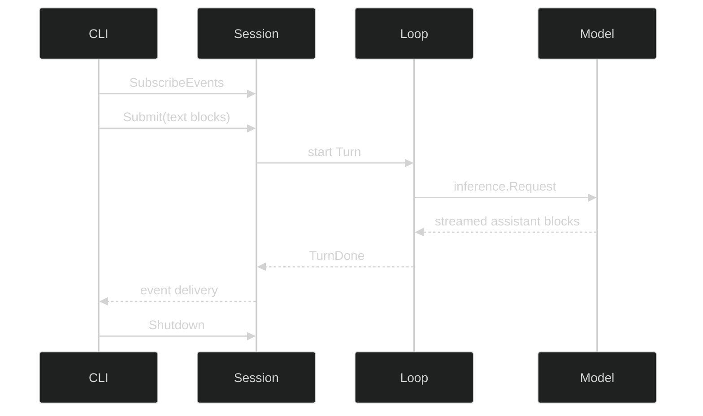

# Run the agent with Harness

Harness turns the model boundary into a stateful agent runtime. A `Loop` freezes one agent definition. A `Rig` combines Loops with the services they share. A `Session` is one live execution of a Rig: it owns turns, events, resources, and shutdown.

Add Harness and Storage to the project:

```sh
go get github.com/looprig/harness@v0.43.0 github.com/looprig/storage@v0.9.0
```

Keep `model.go` from the previous page unchanged, and delete `ask.go`: from here on, Harness makes the model calls.

## Define the Loop and the Rig

Create `agent.go`:

<!-- example: examples/go/start/first-run/agent.go -->
```go
package main

import (
	"github.com/looprig/harness/pkg/loop"
	"github.com/looprig/harness/pkg/rig"
	"github.com/looprig/harness/pkg/sessionstore"
	"github.com/looprig/inference"
	"github.com/looprig/inference/model"
)

// defineAssistant freezes the coding assistant's definition: its name,
// instructions and model. A Loop is configuration, not a running goroutine.
func defineAssistant(client inference.Client, selected model.Model) (loop.Definition, error) {
	return loop.Define(
		loop.WithName("coding-assistant"),
		loop.WithSystem("You are a concise coding assistant. Never claim a file was read unless a tool returned it."),
		// Harness receives the provider-neutral client and its matching model.
		loop.WithInference(client, selected),
	)
}

// defineRuntime assembles the Rig: the Loops a session may run plus the
// services they share. Here that is only the session store.
func defineRuntime(assistant loop.Definition, sessions *sessionstore.Store) (*rig.Rig, error) {
	return rig.Define(
		rig.WithLoops(assistant),
		// A primer is a Loop a new session may start with.
		rig.WithPrimers("coding-assistant"),
		rig.WithSessionStore(sessions),
	)
}
```

The Loop is configuration, not a goroutine. Instructions, tools, gates, and the model belong to it because they define the agent a session runs. The Rig owns topology and shared services, and it validates the whole assembly when you call `rig.Define`.

`sessionstore` here is `github.com/looprig/harness/pkg/sessionstore`, Harness's journal store. It is not the separate `github.com/looprig/sessionstore` module, which holds Factory and Host control records; see the [glossary](/docs/overview/glossary#serving-and-orchestration).

## Run a turn

Create `turn.go`. It is the part most worth copying:

<!-- example: examples/go/start/first-run/turn.go -->
```go
package main

import (
	"context"
	"errors"
	"fmt"
	"io"

	"github.com/looprig/core/content"
	"github.com/looprig/harness/pkg/event"
	"github.com/looprig/harness/pkg/session"
)

// runTurn submits one question to a live session and prints the answer as
// it streams. It returns when the turn ends, when ctx ends, or when the
// event stream closes, whichever happens first.
func runTurn(ctx context.Context, live session.Session, question string, out io.Writer) error {
	// Subscribe before submitting, so no event can pass before we listen.
	// Ephemeral events carry live progress such as token deltas; enduring
	// events are the durable record, including how the turn ended.
	stream, err := live.SubscribeEvents(event.EventFilter{
		Ephemeral: event.LoopScope{All: true},
		Enduring:  event.LoopScope{All: true},
	})
	if err != nil {
		return err
	}
	defer func() { _ = stream.Close() }()

	// Submit queues the question on the active Loop. The outcome arrives as
	// events, not as Submit's return value.
	if _, err := live.Submit(ctx, []content.Block{&content.TextBlock{Text: question}}); err != nil {
		return err
	}
	return waitForTurn(ctx, stream, out)
}

// waitForTurn prints streamed text until the turn reaches one of its three
// terminal events. A subscription stays open after a turn ends, so ranging
// over the channel alone could wait forever: always select on ctx as well.
func waitForTurn(ctx context.Context, stream event.Subscription, out io.Writer) error {
	events := stream.Events()
	for {
		select {
		case <-ctx.Done():
			return fmt.Errorf("waiting for the turn: %w", ctx.Err())
		case delivery, ok := <-events:
			if !ok {
				// The subscription closed, for example because this consumer
				// fell too far behind. Err reports why.
				if err := stream.Err(); err != nil {
					return err
				}
				return errors.New("event stream closed before the turn ended")
			}
			switch ev := delivery.Event.(type) {
			case event.TokenDelta:
				// Live model output. Print text as it arrives.
				if chunk, ok := ev.Chunk.(*content.TextChunk); ok {
					fmt.Fprint(out, chunk.Text)
				}
			case event.TurnDone:
				fmt.Fprintln(out)
				return nil
			case event.TurnFailed:
				// A failed turn carries its typed cause, such as a provider's
				// 401 or a rate limit.
				fmt.Fprintln(out)
				if ev.Err != nil {
					return fmt.Errorf("turn failed: %w", ev.Err)
				}
				return errors.New("turn failed")
			case event.TurnInterrupted:
				fmt.Fprintln(out)
				return errors.New("turn was interrupted")
			}
		}
	}
}
```

Subscribe before you submit, so a fast turn cannot finish before you are listening. `Submit` returns a correlation ID; the outcome arrives as events, because one turn can stream tokens, call tools, pause at a gate, or fail. A turn ends with exactly one of `TurnDone`, `TurnFailed`, or `TurnInterrupted`. The subscription itself stays open after a turn ends and after the session shuts down, so a plain `range` over `Events()` can block forever: always select on the context and treat a closed channel as an error.

## Run a session

Replace `scripted.go` with a reply that fits the new step, and replace `main.go`:

<!-- example: examples/go/start/first-run/scripted.go -->
```go
package main

import (
	"github.com/looprig/inference"
	"github.com/looprig/inference/inferencetest"
)

// scriptedClient stands in for a hosted model. It answers every request with
// the same reply, streamed in small chunks like a real provider.
func scriptedClient() inference.Client {
	return inferencetest.New(
		inferencetest.Text("I can read this repository once you give me tools. " +
			"For now I can only answer from what you tell me.").Repeat(),
	)
}
```

<!-- example: examples/go/start/first-run/main.go -->
```go
package main

import (
	"context"
	"flag"
	"io"
	"log"
	"os"
	"time"

	"github.com/looprig/harness/pkg/sessionstore"
	"github.com/looprig/storage/memstore"
)

func main() {
	question := flag.String("ask", "What can you do?", "question for the coding assistant")
	flag.Parse()

	// Bound the run: a provider that never answers cannot hang the program.
	ctx, cancel := context.WithTimeout(context.Background(), 2*time.Minute)
	defer cancel()

	if err := run(ctx, os.Stdout, os.Stderr, *question); err != nil {
		log.Fatal(err)
	}
}

func run(ctx context.Context, stdout, stderr io.Writer, question string) error {
	client, selected, err := newModel(stderr)
	if err != nil {
		return err
	}
	assistant, err := defineAssistant(client, selected)
	if err != nil {
		return err
	}
	// An in-memory session store. It disappears with the process; a later
	// step replaces it with one on disk.
	sessions, err := sessionstore.Open(memstore.New())
	if err != nil {
		return err
	}
	runtime, err := defineRuntime(assistant, sessions)
	if err != nil {
		return err
	}

	// A Session is one live execution of the Rig.
	live, err := runtime.NewSession(ctx)
	if err != nil {
		return err
	}
	defer func() {
		// Shut down with a fresh deadline: ctx may already have expired, and
		// shutdown still writes its final records.
		shutdownCtx, cancel := context.WithTimeout(context.Background(), 10*time.Second)
		defer cancel()
		if err := live.Shutdown(shutdownCtx); err != nil {
			log.Printf("shutdown: %v", err)
		}
	}()

	return runTurn(ctx, live, question, stdout)
}
```

`memstore` keeps history in memory, so it disappears with the process; the [sessions page](/docs/start/sessions) moves it to disk. `Shutdown` gets a fresh deadline because `ctx` may already have expired, and shutdown still writes its final records.

## Runtime sequence



Read [Harness commands](/docs/guides/harness/commands), [events](/docs/guides/harness/events), [terminal outcomes](/docs/guides/harness/turn/terminal-outcomes), [Loop](/docs/guides/harness/loop), and [Rig](/docs/guides/harness/rig) for the full lifecycle.

## Run it

```sh
go run .
```

```text
OPENAI_API_KEY is not set: using the scripted model
I can read this repository once you give me tools. For now I can only answer from what you tell me.
```

With `OPENAI_API_KEY` and `LOOPRIG_MODEL` set, the answer streams from OpenAI. A bad key ends the turn with `TurnFailed`, and the program exits with the provider's error instead of waiting:

```text
turn failed: inference: api error 401: invalid_api_key
```

## Runnable checkpoint

The complete program is [`examples/go/start/first-run`](https://github.com/looprig/.github/tree/main/examples/go/start/first-run). Its [test](https://github.com/looprig/.github/blob/main/examples/go/start/first-run/main_test.go) runs one turn against the scripted model.

Continue to [add read-only tools and gates](/docs/start/tools-and-gates).
