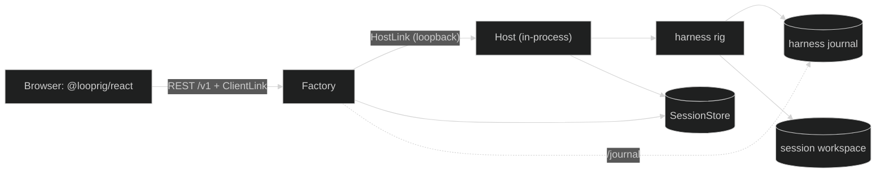

# Starter templates

A starter is a complete application you copy and then change. Each one runs
with `go run .` and no API key, is covered by its own tests, and pins only
released Looprig versions. Use a starter when you want a working whole to edit;
use the [tutorial](/docs/start/choose-a-path) when you want to understand each piece as
you add it.

The starters live in their own repository,
[`github.com/looprig/starters`](https://github.com/looprig/starters). It is a
templates repository, not a library: nothing imports it. Each starter is a
separate Go module with its own tags (`cli-agent/v0.1.0`,
`browser-app/v0.1.0`), re-pinned when Looprig releases move.

## The two starters

| Starter | What you get | Built on |
|---|---|---|
| [`cli-agent`](https://github.com/looprig/starters/tree/cli-agent/v0.1.0/cli-agent) | A terminal coding assistant: reads your repository with Glob, Grep and ReadFile, asks before each write unless an earlier "always" answer in the same run covers it, streams output, and resumes sessions with `--resume <id>`. | harness v0.45.0 (`loop.WithWorkspaceAccess`), tools v0.15.1, inference v0.15.0, llm v0.15.1, fsstore v0.6.0 |
| [`browser-app`](https://github.com/looprig/starters/tree/browser-app/v0.1.0/browser-app) | A multi-user web app in one process: sign in, create sessions, watch text, reasoning and tool steps stream live, approve the agent's file writes in the browser, and restart without losing a conversation. | [Stack](/docs/modules/stack) v0.1.0 (Factory v0.15.0 and an in-process Host v0.17.0), harness v0.45.0, tools v0.15.1, `@looprig/client` and `@looprig/react` 0.3.0 |

Both keep state on local disk with `fsstore`, adapted by
`storage.WithBoundedBlobReaders` so SessionStore accepts it, and both refuse a
data directory written before fsstore v0.6.0 with a "move or delete" message
rather than migrating it.

## Get a starter

Copy a starter with [`gonew`](https://pkg.go.dev/golang.org/x/tools/cmd/gonew),
which downloads the module through the Go module proxy, writes it into a new
directory, and renames its module path. It needs Go 1.26.8 or later; the
browser app's UI also needs Node 22 or later.

```sh
go run golang.org/x/tools/cmd/gonew@latest github.com/looprig/starters/cli-agent example.com/myapp
cd myapp
```

For the browser app:

```sh
go run golang.org/x/tools/cmd/gonew@latest github.com/looprig/starters/browser-app example.com/myapp
cd myapp
```

`gonew` writes into `./myapp`, the last element of the new module path, which
must not exist yet. Without a version it takes the starter's latest tag; add
one, as in `github.com/looprig/starters/cli-agent@v0.1.0`, to pin it.
Everything is in package `main`, and the copy has no `replace` directives, so
it builds anywhere. The commands below run from `myapp`.

## cli-agent

Run it without a key. With no provider set, a scripted model from
`inference/inferencetest` answers:

```sh
go run .
> what is here?                  # the scripted model lists the repository with Glob
> write notes.txt hello          # it asks to write; answer y, a (always) or n
```

The agent works on the current directory, or the directory `--root` names.
Its access gate is one option, `loop.WithWorkspaceAccess`: reads inside the
repository run, a write inside it asks you first through a `gate.ApproverFunc`
that reads the terminal, and reads or writes outside it, commands, and network
access are denied without asking. An `a` answer is remembered in memory for
the rest of the run and never widens access past the repository.
`--read-only` drops the write tools and uses `loop.WithReadOnlyAccess(root)`
instead.

Each run prints its session id, and `go run . --resume <id>` continues that
conversation. `go run . -p "what is here?"` runs one prompt and exits. Test it
with `GOWORK=off go test -race ./...`; the tests run scripted turns that read,
write with approval, remember "always", refuse out-of-root access, resume,
and refuse a legacy data directory. The starter's README maps each file.

## browser-app

Build the UI once, then run the app without a key:

```sh
(cd web && npm ci && npm run build)   # Go embeds web/dist
go run .
```

The process prints its address and where to find the development sign-in
token. The token is a credential, so it is written to `data/dev-token` rather
than printed. Open `http://127.0.0.1:8080/dev/login`, sign in with any
username and that token, and create a session. The keyless model reasons
briefly, calls a `current_time` tool and streams a reply. Start a session with
`write notes.txt hello` and the model asks to write that file: an approval card
appears, and the file lands in the session's workspace under `data/workspaces/`
only after someone approves. Sign in as a second user in another browser to
watch the same session live and answer its gates.



The whole composition is one `stack.Start` call in `app.go`: Factory, one
in-process pooled Host running the agent through `host/harnessruntime`, local
storage from `stack/localdisk`, and development-only sign-in from
`stack/devauth`. Factory still reaches the Host over a loopback HostLink
WebSocket, exactly as it would a remote one. The agent in `agent.go` uses
`loop.WithWorkspaceAccess` with its default approver, the Loop's durable
permission gate, which the browser answers through Factory.
`LOOPRIG_READ_ONLY=1` switches to `loop.WithReadOnlyAccess` and drops the write
tools.

Stack v0.1.0 exposes no workspace snapshot store, so the starter opens its own
in a separate `fsstore` directory, `data/snapshots`, beside the roots
`localdisk` manages. Keep that store durable: Host checkpoints a session's
workspace into it on release and restores the workspace from it, and a session
restored after a restart against an in-memory snapshot store fails with the
`materialize_failed` restore error.

For UI work, run `npm run dev` in `web/` beside `go run .`; Vite proxies `/v1`
and `/dev` to the Go process. Test with `GOWORK=off go test -race ./...`, which
boots the app, creates a session and sends input over Factory's REST API,
answers a write gate, restarts over the same data and restores, and refuses a
legacy data directory; then run `npm run typecheck && npm run build` in `web/`.

## Use a real model

Both starters read the same environment variables:

| Variable | Meaning |
|---|---|
| `LOOPRIG_PROVIDER` | `openai`, `anthropic`, `ollama`, `llama.cpp`, `lmstudio`, or another provider that `llm`'s `auto.New` can construct from a model and one key (`openrouter`, `groq`, `google`, ...). Unset means the scripted model. |
| `LOOPRIG_MODEL` | The provider's model name. |
| `LOOPRIG_API_KEY` | The key. Local models need none. |
| `LOOPRIG_BASE_URL` | Optional: an OpenAI-compatible endpoint, or a non-default local port. |
| `LOOPRIG_API_FORMAT` | Optional: `openai`, `openai-responses`, `anthropic` or `gemini`. The default is `anthropic` for `anthropic` and `openai` otherwise; set it for a provider that speaks something else (`gemini` for `google`, `openai-responses` for `azure`, `anthropic` for `minimax` and `google-vertex-anthropic`). |
| `LOOPRIG_CONTEXT_WINDOW` | Optional: the context window in tokens (default 128000). |

```sh
LOOPRIG_PROVIDER=anthropic LOOPRIG_MODEL=claude-sonnet-4-5 LOOPRIG_API_KEY=... go run .
LOOPRIG_PROVIDER=openai LOOPRIG_MODEL=gpt-4.1 LOOPRIG_API_KEY=... go run .
LOOPRIG_PROVIDER=ollama LOOPRIG_MODEL=qwen3 go run .
LOOPRIG_PROVIDER=google LOOPRIG_API_FORMAT=gemini LOOPRIG_MODEL=gemini-2.5-flash LOOPRIG_API_KEY=... go run .
```

Two providers need a code change in `provider.go`: `auto.New` refuses
`bedrock`, which needs AWS SigV4 credentials (`bedrock.New`), and `phala`,
which needs an attestation acceptance policy (`phala.New`). Providers whose
credential is not a static API key (`google-vertex`, `github-copilot`,
`gitlab`, `sap-ai-core`, `snowflake-cortex`) receive `LOOPRIG_API_KEY` as an
already-issued token; the starters do not obtain or refresh it. The browser app
also reads `LOOPRIG_ADDR` (default `127.0.0.1:8080`), `LOOPRIG_DATA` (default
`./data`) and `LOOPRIG_DEV_TOKEN`.

## What to change for production

| Area | cli-agent | browser-app |
|---|---|---|
| Identity | Not applicable: it runs as you. | Replace `stack/devauth`, which lets anyone with the token sign in as anyone. Give `stack.Options.Identity` an `identity.Verifier` over your identity provider and a `factory.Authorizer` with real ownership rules, then drop `AllowDevelopmentIdentity`. Until then every signed-in user can read, drive and approve writes in every session. |
| Secrets | Share nothing. | Give every Factory replica the same CSRF key and list your real origins in `Origins`. |
| Approvals | "Always" lasts only for the process. Pass a durable `gate.RuleStore` in `loop.WorkspaceAccess.Rules` to keep rules across restarts; a store that implements `gate.PolicyRevisioner` joins the Loop's policy identity. | The same: "Approve always" lasts for that session while the process runs unless `Rules` is durable. |
| Storage | `fsstore` with bounded readers is fine for one local process. | `localdisk` is for one process on one machine. For several processes, use backends that implement `storage.BlobReaderLifecycle` natively, such as `natsstore`, or `pgstore` with `s3store`, for the control store, each tenant's journal and the workspace snapshots, and move Hosts out with `stack.RemoteHosts{}` plus `stack.ServeHost`. Session workspaces then need storage every Host can reach. |
| Commands | `WithWorkspaceAccess` denies `command.execute`. To add Bash, run it under `sandbox`, call `sandbox.Init()` first in `main`, and compose your own `gate.Evaluator` from `gate.WorkspaceAccess`'s bindings plus a command route to the sandbox. Never allow commands unconfined. | The same, and declare the tool's capture safety honestly in the agent's `department.Capabilities`. |
| Shutdown | The CLI shuts its session down within 10 seconds of Ctrl-C or SIGTERM; give a supervisor more than that. | Give `Stop` and the platform's termination grace more than the Host drain's `Grace` + 2 × `IdleBoundary`, 20 seconds at the stack defaults. A session waiting at a gate uses the whole `Grace` before Host abandons it with the gate preserved for the next start; a shorter budget kills the process mid-abandon. |
| Upgrades | The roots and any revisioned rule store make up the Loop's policy identity, which a restored session checks. | Change `compatibilityID` in `app.go` when a new build cannot restore an old journal. |
