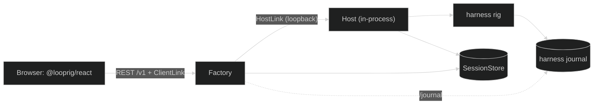

# Starter templates

A starter is a complete application you copy and then change. Each one runs
with `go run .` and no API key, is covered by its own tests, and pins only
released Looprig versions. Use a starter when you want a working whole to edit;
use the [tutorial](/docs/start/choose-a-path) when you want to understand each piece as
you add it.

## The two starters

| Starter | What you get | Looprig modules |
|---|---|---|
| [`cli-agent`](https://github.com/looprig/.github/tree/main/examples/starters/cli-agent) | A terminal coding assistant: reads your repository with Glob, Grep and ReadFile, asks before every write, streams output, and resumes sessions with `--resume <id>`. | harness v0.43.0, tools v0.15.0, inference v0.15.0, llm v0.15.1, fsstore v0.6.0, storage v0.9.0 |
| [`browser-app`](https://github.com/looprig/.github/tree/main/examples/starters/browser-app) | A multi-user web app in one process: Factory's API and browser link, an in-process Host running the agent, dev-only sign-in, and a React UI that streams text, reasoning and tool steps live. | factory v0.15.0, host v0.15.1, harness v0.43.0, sessionstore v0.14.0, fsstore v0.6.0, storage v0.9.0, `@looprig/client` and `@looprig/react` 0.3.0 |

Both keep state on local disk with `fsstore`, adapted by
`storage.WithBoundedBlobReaders` so SessionStore accepts it, and both refuse a
data directory written before fsstore v0.6.0 with a "move or delete" message
rather than migrating it.

## Get a starter

The starters live in the `looprig/.github` documentation repository. Its path
begins with a dot, which Go does not allow in a module path, so `gonew` cannot
fetch them. Copy one with a sparse Git checkout instead:

```sh
git clone --depth 1 --filter=blob:none --sparse https://github.com/looprig/.github looprig-starters
cd looprig-starters
git sparse-checkout set examples/starters/browser-app   # or examples/starters/cli-agent
cp -R examples/starters/browser-app ~/src/myapp
cd ~/src/myapp
go mod edit -module example.com/myapp                   # optional: everything is package main
```

Each starter is its own Go module with no `replace` directives, so the copy
builds anywhere. It needs Go 1.26.8 or later; the browser app's UI also needs
Node 22 or later.

## cli-agent

```sh
cd cli-agent
go run .                         # keyless: a scripted model
> what is here?                  # lists the repository with Glob
> write notes.txt hello          # asks to write; answer y or n
```

Each run prints its session id. `go run . --resume <id>` continues that
conversation, `--root` points the agent at another repository, and
`--read-only` removes the write tools and uses `loop.WithReadOnlyAccess(root)`,
the one-option read gate. Test it with `GOWORK=off go test ./...`; the tests
run scripted turns that call tools end to end.

The starter's README maps each file: provider selection, the loop and rig, the
access gate (reads allowed inside the repository, writes gated through
harness's approval gate), and storage.

## browser-app

```sh
cd browser-app
(cd web && npm ci && npm run build)   # once; Go embeds web/dist
go run .
```

The process prints its address and a development token. Open
`http://127.0.0.1:8080/dev/login`, sign in with any username and that token,
and create a session. The keyless model reasons briefly, calls a
`current_time` tool and streams a reply. Sign in as a second user in another
browser to watch the same session live.



Factory and Host run in one process but still talk only over HostLink and
SessionStore, so moving the Host to its own machine later changes the
composition file and nothing else. For UI work run `npm run dev` in `web/`
beside `go run .`; Vite proxies `/v1` to the Go process. Test with
`GOWORK=off go test ./...`, which boots the app, creates a session and sends
input through the Factory REST API, restarts over the same data, and reads the
journal; and `npm run typecheck && npm run build` in `web/`.

Host publishes no Harness adapter, so the starter carries one in
`runtime.go`. Its comments mark the obligations that fail silently when
missed: launching under the binding's runtime id, copying `Principal` and
`Metadata`, and forwarding `AttemptCloser`, `PersistenceFaults` and
`LiveOptionsSubscriber`.

## Use a real model

Both starters read the same environment variables:

| Variable | Meaning |
|---|---|
| `LOOPRIG_PROVIDER` | `openai`, `anthropic`, `ollama`, `llama.cpp`, `lmstudio`, or another provider name from `llm`. Unset means the scripted model. |
| `LOOPRIG_MODEL` | The provider's model name. |
| `LOOPRIG_API_KEY` | The key. Local models need none. |
| `LOOPRIG_BASE_URL` | Optional: an OpenAI-compatible endpoint, or a non-default local port. |
| `LOOPRIG_API_FORMAT` | Optional: `openai`, `openai-responses` or `anthropic`. |
| `LOOPRIG_CONTEXT_WINDOW` | Optional: the context window in tokens (default 128000). |

```sh
LOOPRIG_PROVIDER=anthropic LOOPRIG_MODEL=claude-sonnet-4-5 LOOPRIG_API_KEY=... go run .
LOOPRIG_PROVIDER=openai LOOPRIG_MODEL=gpt-4.1 LOOPRIG_API_KEY=... go run .
LOOPRIG_PROVIDER=ollama LOOPRIG_MODEL=qwen3 go run .
```

## What to change for production

| Area | cli-agent | browser-app |
|---|---|---|
| Identity | Not applicable: it runs as you. | Replace `devauth.go`, which lets anyone with the token sign in as anyone. Implement `identity.Verifier` over your identity provider and `factory.Authorizer` with real ownership rules. |
| Secrets | Share nothing. | Give every Factory replica the same CSRF key and list your real origins in `TrustedOrigins`. Keep the HostLink token secret and the HostLink off the public network. |
| Storage | `fsstore` with bounded readers is fine for one local process. | The same holds for one process. For several processes or machines, use backends that implement `storage.BlobReaderLifecycle` natively, such as `natsstore`, or `pgstore` with `s3store`, for the control store and each tenant's journal. |
| Tools | Persist approval rules with `tools/permission`. Run any Bash tool under `sandbox`, and call `sandbox.Init()` first in `main`. | Add real tools with a real access gate, and show approval gates in the UI with `useFactoryGate`. |
| Upgrades | Bump the policy revision when the gate changes. | Bump `compatibilityID` when a new build cannot restore an old journal, and give each Host restart a higher generation. |
