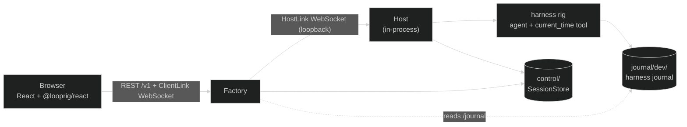

# browser-app starter

A multi-user web app on Looprig in one process: sign in, create agent
sessions, watch replies stream word by word with reasoning and live tool
steps, and send more input. Reload the page, or restart the process, and every
conversation is still there. It is a starting point to copy and change, not a
library.



| Piece | What it is here |
|---|---|
| Factory v0.15.0 | The public API (`/v1`), browser realtime link, sign-in, CSRF, command admission and placement. |
| Host v0.15.1 | Runs agent sessions. It is in the same process but talks to Factory over a loopback WebSocket, exactly as a remote Host would. |
| harness v0.43.0 | The agent: one loop with a `current_time` tool. |
| Storage | Two local `fsstore` roots under `data/`, adapted with `storage.WithBoundedBlobReaders` (storage v0.9.0). |
| Identity | **Development only**: any username plus a shared token. See `devauth.go`. |
| UI | `web/`, Vite + React + TypeScript on `@looprig/client` and `@looprig/react` 0.3.0 from npm. |

## Get it

Copy this directory, or use the `git` command in
[`docs/start/starters.md`](../../../docs/start/starters.md). Rename the module
in `go.mod` (`example.com/browser-app`) if you like; everything is in
package `main`.

## Run it without a key

Requires Go 1.26.8 and Node 22 or later.

```sh
(cd web && npm ci && npm run build)   # once; Go embeds web/dist
go run .
```

```text
browser-app listening on http://127.0.0.1:8080 (data in .../data)
DEV sign-in: open http://127.0.0.1:8080/dev/login, any username, token 3f0c...
```

Open the URL, sign in with any username and the printed token, and create a
session. The keyless scripted model thinks for a moment, calls `current_time`,
and streams a reply that quotes your message. Sign in as a second user in
another browser: both can open the same session and watch it update live.

`go run .` works before the UI is built too: the API is up, and the page tells
you to build the UI. Set `LOOPRIG_DEV_TOKEN` to keep the token stable across
restarts.

### Drive it with curl

```sh
T=alice:$LOOPRIG_DEV_TOKEN
SID=$(uuidgen | tr A-Z a-z); CID=$(uuidgen | tr A-Z a-z)
curl -H "Authorization: Bearer $T" -H 'Content-Type: application/json' \
  -d '{"version":1,"command_id":"'$CID'","session_id":"'$SID'","agent_id":"assistant","blocks":[{"type":"text","Text":"hello"}]}' \
  http://127.0.0.1:8080/v1/sessions
curl -H "Authorization: Bearer $T" http://127.0.0.1:8080/v1/sessions/$SID/journal
```

A bearer request skips CSRF; the browser uses the `looprig_dev` cookie and
Factory's CSRF token instead. Note the block field is `Text`, Core's
content-block encoding.

### Work on the UI

```sh
go run .                 # terminal 1: Factory on :8080
cd web && npm run dev    # terminal 2: Vite on :5173, proxying /v1 and /dev to :8080
```

Open http://localhost:5173. `FACTORY_URL` points the proxy elsewhere.

## Run it with a real model

The same variables as the cli-agent starter:

| Variable | Meaning |
|---|---|
| `LOOPRIG_PROVIDER` | `openai`, `anthropic`, `ollama`, `llama.cpp`, `lmstudio`, or another `llm` provider name. Unset means the scripted model. |
| `LOOPRIG_MODEL` | The provider's model name. |
| `LOOPRIG_API_KEY` | The key. Local providers need none. |
| `LOOPRIG_BASE_URL` | Optional: an OpenAI-compatible endpoint, or a non-default local port. |
| `LOOPRIG_API_FORMAT` | Optional: `openai`, `openai-responses` or `anthropic`. |
| `LOOPRIG_CONTEXT_WINDOW` | Optional: context window in tokens (default 128000). |

```sh
LOOPRIG_PROVIDER=anthropic LOOPRIG_MODEL=claude-sonnet-4-5 LOOPRIG_API_KEY=... go run .
LOOPRIG_PROVIDER=ollama LOOPRIG_MODEL=qwen3 go run .
```

Other settings: `LOOPRIG_ADDR` (default `127.0.0.1:8080`), `LOOPRIG_DATA`
(default `./data`).

## Files

| File | What it does |
|---|---|
| `main.go` | Environment, signals, the HTTP server, shutdown. |
| `app.go` | The composition: storage, Host, Factory, and the shutdown order. |
| `runtime.go` | Adapts a harness session to Host's `department` seam. Host ships no public adapter, so every product carries this file. |
| `agent.go` | The agent: loop, access gate and the `current_time` tool. |
| `provider.go` | Model selection from the environment, and the keyless script. |
| `devauth.go` | **Dev-only** credential verifier, authorizer and `/dev/login`. |
| `ui.go` | Serves the embedded `web/dist` with an SPA fallback. |
| `app_test.go` | Boots the app, creates a session and sends input over REST, reads the journal; restarts over the same data; refuses a legacy data directory. |
| `web/` | The React app. |

## Test

```sh
GOWORK=off go test ./...
(cd web && npm ci && npm run typecheck && npm run build)
```

## Obligations the code comments call out

These are the easy-to-miss rules from the Factory and Host release notes. Each
is marked in the source.

- `runtime.go` launches under `RigSessionID` (Host refuses anything else),
  copies `Principal` and `Metadata` into `runtimecommand.Admitted`, decodes a
  create's first message, and forwards `AttemptCloser`,
  `PersistenceFaults` and `LiveOptionsSubscriber`. Without the first two a
  crash or storage outage can wedge a session's command stream forever;
  without the third, tool steps never stream.
- `app.go` gives Factory `WithPendingCommands` (without it nothing is ever
  placed), a journal resolver wrapped in `host.NewPublicJournals` (so no
  runtime id reaches a browser), and a bare HostLink base address. The Host
  generation must grow on every restart.
- A pre-v0.6.0 `fsstore` directory is refused with "move or delete": there is
  no migration and retrying cannot help.
- If you add sandboxed tools (Bash), call `sandbox.Init()` first in `main`.

## Before you ship it

- **Identity:** replace `devauth.go`. Implement `identity.Verifier` over your
  identity provider (signed session cookie or OIDC token) and
  `factory.Authorizer` with real ownership rules; today every user in the
  tenant can read and drive every session.
- **CSRF key:** it is random per process. Several Factory replicas must share
  one key (`identity.CSRFConfig.SharedKey`), and `TrustedOrigins` must list
  your real origin.
- **Storage:** `fsstore` with bounded readers suits one process on one
  machine. For several processes, use backends that implement
  `storage.BlobReaderLifecycle` natively, such as `natsstore`, or `pgstore`
  with `s3store`, for both the control store and each tenant's journal.
- **Separate Hosts:** when you outgrow one process, run Hosts elsewhere with
  the same `runtime.go`. Give each a real `HostID`, a persisted increasing
  generation and a secret HostLink token, and keep the HostLink off the public
  network.
- **Tools and gates:** the agent's access gate allows only requirement-free
  tools. File tools need `loop.WithReadOnlyAccess` or a real evaluator, and
  approval gates need the gate UI (`useFactoryGate`) in the app.
- **Compatibility:** bump `compatibilityID` in `app.go` when a new build
  cannot restore an old journal.
